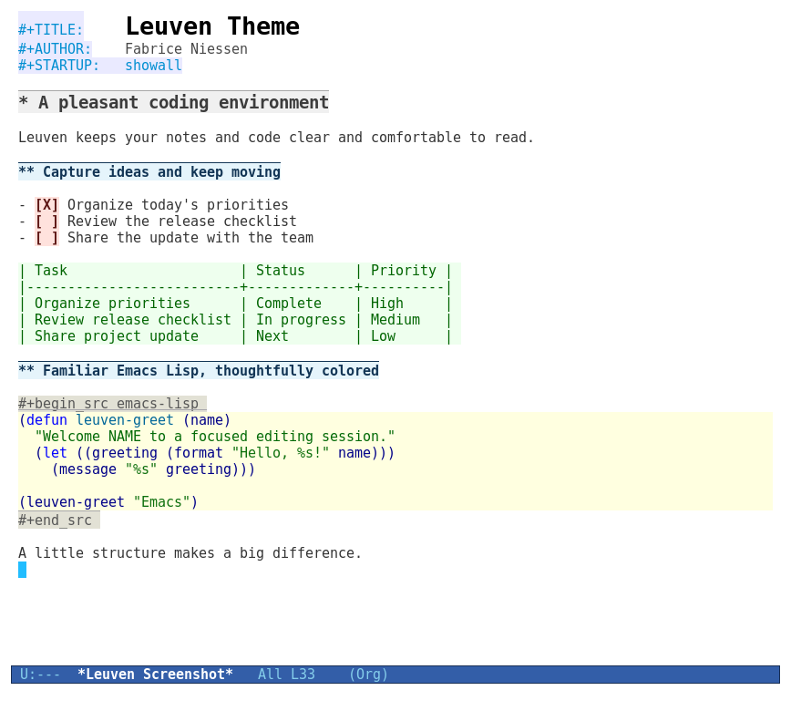
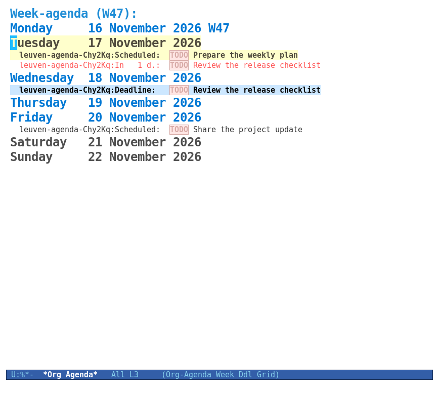
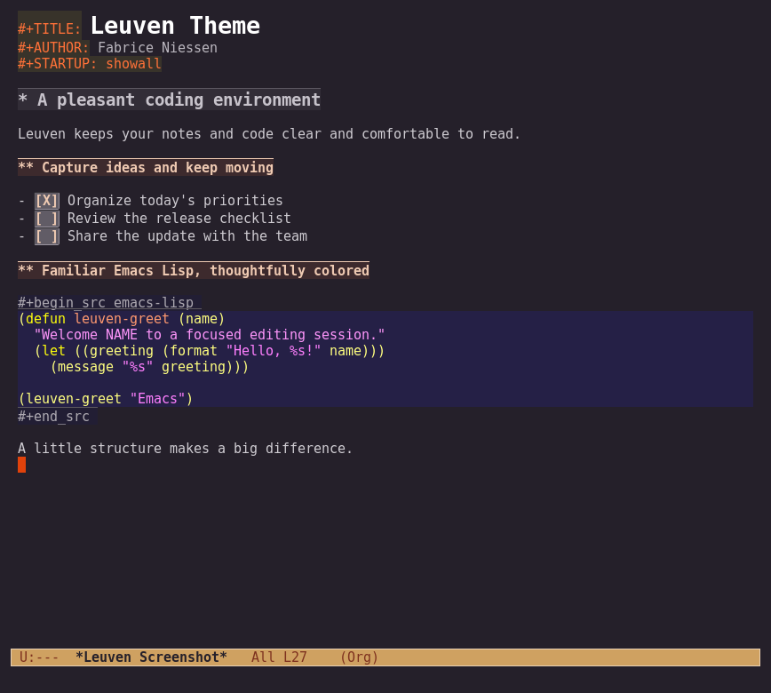

#+TITLE:     Leuven-theme
#+AUTHOR:    Fabrice Niessen
#+EMAIL:     (concat "fniessen" at-sign "pirilampo.org")
#+DESCRIPTION: Light and dark themes for Emacs, with particular attention to Org mode
#+KEYWORDS:  Emacs, color theme, syntax highlighting, coding
#+LANGUAGE:  en

#+SETUPFILE: ~/org/setup/html-theme-readtheorg.setup

#+PROPERTY:  header-args :eval no

[[https://www.gnu.org/licenses/gpl-3.0.html][https://img.shields.io/badge/license-GPL--3.0--or--later-blue.svg]]
[[https://melpa.org/#/leuven-theme][https://melpa.org/packages/leuven-theme-badge.svg]]
[[https://www.paypal.com/cgi-bin/webscr?cmd=_donations&business=VCVAS6KPDQ4JC&lc=BE&item_number=emacs%2dleuven%2dtheme&currency_code=EUR&bn=PP%2dDonationsBF%3abtn_donate_LG%2egif%3aNonHosted][https://www.paypalobjects.com/en_US/i/btn/btn_donate_LG.gif]]

Leuven is an Emacs color theme designed for readability, with particular
attention to Org mode.  It also includes styles for Magit, Gnus, Dired+, EDiff,
and many other packages.

Choose =leuven= for a light background or =leuven-dark= for a dark background.  The
dark variant was originally generated by Thibault Polge.

* Screenshots

** Light theme: Org buffer

Fontified source code blocks:

#+ATTR_HTML: :width 640

** Light theme: agenda

Agenda with task list:

#+ATTR_HTML: :width 640

** Dark theme: Org buffer

#+ATTR_HTML: :width 640

* Installation and activation

The themes require Emacs 24 or later.  The light theme has been included in
Emacs since version 24.4; try it with ~M-x load-theme RET leuven RET~.  For an
updated version and the dark variant, install the package or use Git.

** Install from MELPA

[[https://melpa.org/#/leuven-theme][MELPA]] provides development snapshots of =leuven-theme=.  See the
[[https://melpa.org/#/getting-started][MELPA setup instructions]] for details.

1. Add MELPA to your Emacs initialization file (such as =~/.emacs= or
   =~/.emacs.d/init.el=) and evaluate this code:

   #+begin_src emacs-lisp
   (require 'package)
   (add-to-list 'package-archives '("melpa" . "https://melpa.org/packages/") t)
   #+end_src

2. Run ~M-x package-refresh-contents~.

3. Run ~M-x package-install RET leuven-theme RET~.

** Install from Git

Get the full Git repository at https://github.com/fniessen/emacs-leuven-theme
using the following command:

#+begin_src shell
git clone https://github.com/fniessen/emacs-leuven-theme
#+end_src

Add the theme directory to your Emacs initialization file, replacing the
placeholder with the path to your clone:

#+begin_src emacs-lisp
(add-to-list 'custom-theme-load-path "/path/to/emacs-leuven-theme/lisp")
#+end_src

** Activate a theme

After installation, add *one* of these forms to your Emacs initialization file:

#+begin_src emacs-lisp
(load-theme 'leuven t)
#+end_src

Or, for the dark variant:

#+begin_src emacs-lisp
(load-theme 'leuven-dark t)
#+end_src

To use the dark theme with [[https://github.com/jwiegley/use-package][use-package]], use the following:

#+begin_src emacs-lisp
(use-package leuven-theme
  :ensure t
  :no-require t
  :config
  (load-theme 'leuven-dark t))
#+end_src

Restart Emacs to apply your configuration.

* Customization

** Text scaling

To keep Org level-1 headings at their normal size, set the corresponding option
to ~nil~ *before loading the theme*:

#+begin_src emacs-lisp
(setq leuven-scale-outline-headlines nil)
;; For dark theme:
(setq leuven-dark-scale-outline-headlines nil)
#+end_src

Other settings you might want to consider:

#+begin_src emacs-lisp
(setq leuven-scale-org-agenda-structure nil)
(setq leuven-scale-org-document-title nil)
(setq leuven-scale-volatile-highlight nil)
;; For dark theme:
(setq leuven-dark-scale-org-agenda-structure nil)
(setq leuven-dark-scale-org-document-title nil)
(setq leuven-dark-scale-volatile-highlight nil)
#+end_src

The value can be:
- ~nil~ for unscaled,
- ~t~ for using the theme default, or
- a scaling number (that you choose to your liking!).

You can also use ~M-x customize-variable~ to save these options, then restart
Emacs to apply them.

** Full-width Org headings

To extend heading background colors across the whole line, add:

#+begin_src emacs-lisp
(setq org-fontify-whole-heading-line t)
#+end_src

* Testimonials

"Your Org-enhancing color-theme "leuven" ROCKS! ... and not just for Org." \\
-- /Johan S./

"Amazing theme. I've been switching themes like socks the past 3 years and
finally found a theme that fits me exactly." \\
-- /zeltak/

"The Leuven theme has quickly become my favorite -- the colors are great and the
visual details for Org mode are just wonderful." \\
-- /Steve B./

"I'm using leuven theme, which is a great theme for Org-mode. [...]  I cannot
use another emacs-theme." \\
-- /Joseph Vidal-Rosset/

"Leuven theme is awesome!" \\
-- /Joost Diepenmaat/

"I still am really enjoying using the theme -- wish I'd had it years back..." \\
-- /V./

"I've been using leuven-theme, which is a fantastic theme for Org-mode files."
\\
-- /thnetos/

"I love leuven for it's magit faces. E.g. the different sections of the magit
status screen stand out much better with leuven than with any other theme I've
tried.  It's a good looking theme but what makes it stand out is the attention
the author has put into all of the different faces you find everywhere." \\
-- /UnwashedMeme/

* Development and contribution

** Issues

Report issues and suggest features and improvements on the [[https://github.com/fniessen/emacs-leuven-theme/issues/new][GitHub issue tracker]].

** Patches

I love contributions!  Patches under any form are always welcome!

** Tests and shell checks

Run =make test= to run the theme's ERT tests (requires Emacs).  Run
=make lint-shell= to check the shell scripts (requires ShellCheck).  Run =make all=
to run both sets of checks, or =make help= to list the targets.

** Regenerate the dark theme

Run =make dark-theme= to regenerate [[./lisp/leuven-dark-theme.el][lisp/leuven-dark-theme.el]] from
[[./lisp/leuven-theme.el][lisp/leuven-theme.el]] using the color inversion helper (requires Python 3).  This
overwrites any manual changes to the dark theme, so save them first.  The target
is intentionally separate from =make all= and =make screenshots=; review the
generated palette before using it.

** Regenerate screenshots

Run =make screenshots= to regenerate the images in [[./images/][images/]] with the current theme
colors.  This target requires a graphical build of Emacs, ImageMagick, and Xvfb;
it is intentionally separate from =make all=.

* Related links

** Vim port

A Vim port of the Leuven theme has been created by Guilherme Zagatti and is
available at https://github.com/gzagatti/vim-leuven-theme.  His port strives to
remain as faithful as possible to my original Emacs color scheme, while taking
into account the limitations of the Vim environment.

** Emacs training

For hands-on Emacs training with the theme's author, visit [[https://emacsboost.com/en/][EmacsBoost]] for course
details, dates, and locations.

* Donations

If you use the emacs-leuven-theme project and feel it is making your life better
and easier, you can show your appreciation and help support future development
by making a [[https://www.paypal.com/cgi-bin/webscr?cmd=_donations&business=VCVAS6KPDQ4JC&lc=BE&item_number=emacs%2dleuven%2dtheme&currency_code=EUR&bn=PP%2dDonationsBF%3abtn_donate_LG%2egif%3aNonHosted][donation]] through PayPal.  Thank you!

Regardless of the donations, emacs-leuven-theme will always be free both as in
beer and as in speech.

* License

Emacs-Leuven-Theme \\
Copyright (C) 2003-2026 Free Software Foundation, Inc.

This program is free software: you can redistribute it and/or modify it under
the terms of the GNU General Public License as published by the Free Software
Foundation, either version 3 of the License, or (at your option) any later
version.

This program is distributed in the hope that it will be useful, but WITHOUT ANY
WARRANTY; without even the implied warranty of MERCHANTABILITY or FITNESS FOR
A PARTICULAR PURPOSE.  See the GNU General Public License for more details.

You should have received a copy of the GNU General Public License along with
this program.  If not, see https://www.gnu.org/licenses/.
